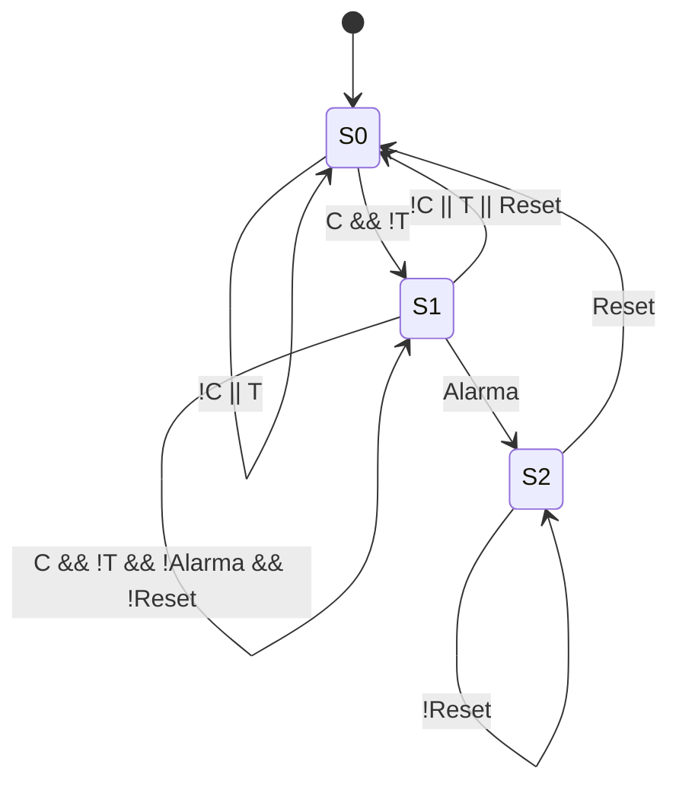

# Máquina de estados — Bomba automática

## 1. Objetivo

Definir la lógica de control de una bomba que transfiere agua desde una cisterna hacia un tinaco mediante un ESP32. El sistema dispone de modos de operación manual y automático, un temporizador de seguridad y una alarma enclavada.

## 2. Entradas

| Variable | Descripción | Estado lógico 1 |
|---|---|---|
| `C` | Disponibilidad de agua en la cisterna | Agua suficiente para bombear |
| `T` | Nivel del tinaco | Tinaco lleno |
| `Reset` | Restablecimiento manual | Reset accionado |

## 3. Salidas

| Variable | Descripción | Estado lógico 1 |
|---|---|---|
| `B` | Mando de la bomba | Bomba habilitada |
| `Temp_EN` | Habilitación del temporizador | Temporizador contando |
| `Alarma_OUT` | Indicador de alarma, opcional | Alarma activa |

## 4. Variables internas

| Variable | Descripción |
|---|---|
| `Estado` | Estado actual: `S0`, `S1` o `S2` |
| `Alarma` | Indica que se agotó el tiempo máximo de bombeo |
| `TiempoInicio` | Instante de inicio del temporizador |
| `TiempoMax` | Tiempo máximo permitido de bombeo |

`Alarma` es una variable interna generada por el temporizador del ESP32. No es una entrada física.

## 5. Definición de estados

| Estado | Nombre | Bomba | Temporizador | Descripción |
|---|---|---|---|---|
| `S0` | Reposo | 0 | 0 | Bomba apagada; espera condiciones de arranque |
| `S1` | Bombeo | 1 | 1 | Bomba encendida y temporizador activo |
| `S2` | Alarma enclavada | 0 | 0 | Bomba apagada hasta el restablecimiento manual |

## 6. Condiciones de transición

| Estado actual | Condición | Estado siguiente |
|---|---|---|
| `S0` | `C && !T` | `S1` |
| `S0` | `!C || T` | `S0` |
| `S0` | `Reset` | `S0` |
| `S1` | `Alarma` | `S2` |
| `S1` | `!C || T || Reset` | `S0` |
| `S1` | `C && !T && !Alarma && !Reset` | `S1` |
| `S2` | `Reset` | `S0` |
| `S2` | `!Reset` | `S2` |

**Prioridad de las condiciones:** la alarma tiene prioridad sobre la continuidad del bombeo. Las condiciones de nivel y el reset detienen la bomba cuando corresponde.

## 7. Diagrama de estados

## 8. Comportamiento de la alarma

Cuando el temporizador alcanza `TiempoMax` durante `S1`, el sistema activa `Alarma` y transita a `S2`. La bomba se apaga y el estado de alarma permanece enclavado aunque cambien las señales de nivel.

Al accionar `Reset`, el sistema regresa a `S0`. El reinicio no debe provocar un arranque directo: las condiciones de operación segura deben evaluarse nuevamente.

## 9. Criterios de aceptación

- La bomba solo puede encenderse si hay agua suficiente en la cisterna y el tinaco no está lleno.
- La bomba se apaga cuando el tinaco se llena o la cisterna deja de tener agua suficiente.
- Si se agota el temporizador durante `S1`, el sistema entra en `S2`.
- El sistema permanece en `S2` hasta que se accione `Reset`.
- La pérdida de conexión Wi-Fi no afecta la lógica de control local.

## 10. Pendientes de validación

- Definir el valor de `TiempoMax`.
- Definir el comportamiento exacto de la señal de alarma al accionar `Reset`.
- Verificar la prioridad de las condiciones simultáneas.
- Validar los sensores y las protecciones eléctricas durante las pruebas.

> Nota: esta máquina de estados describe la lógica funcional prevista. La implementación final debe incorporar las protecciones eléctricas y las condiciones de seguridad necesarias para la instalación.
