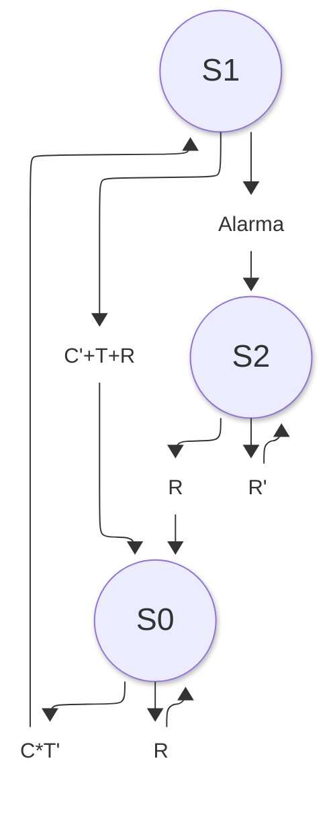

## Diagrama de estados

# 03. Máquina de estados

## 1. Descripción

La máquina de estados controla el funcionamiento de una bomba de agua mediante un ESP32. El sistema opera en tres estados: reposo, bombeo y alarma enclavada.

## 2. Variables de entrada

| Variable | Tipo | Descripción |
|---|---|---|
| `C` | Digital | `1`: hay agua suficiente en la cisterna. `0`: agua insuficiente. |
| `T` | Digital | `1`: el tinaco está lleno. `0`: el tinaco no está lleno. |
| `R` | Digital | `1`: se solicita restablecimiento manual. `0`: sin solicitud. |
| `Alarma` | Interna | `1`: se superó el tiempo máximo de bombeo. |

## 3. Definición de estados

| Estado | Nombre | Comportamiento |
|---|---|---|
| `S0` | Reposo | Bomba apagada y alarma no enclavada. |
| `S1` | Bombeo | Bomba encendida y temporizador de seguridad activo. |
| `S2` | Alarma enclavada | Bomba apagada; requiere restablecimiento manual. |
