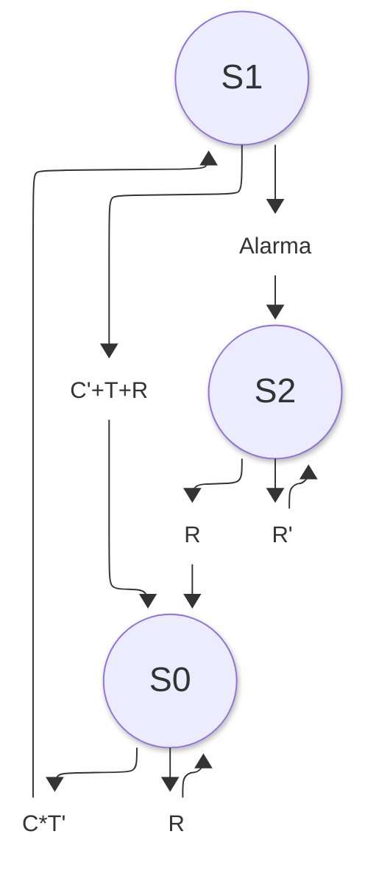

###Diagrama de estados

C = 1: hay agua suficiente en la cisterna.
T = 1: el tinaco está lleno.
R = 1: se solicita restablecimiento manual.
Alarma = 1: se superó el tiempo máximo permitido de bombeo.
B = 1: comando de encendido de la bomba.
S0: bomba apagada y sin alarma enclavada.
S1: bomba encendida y temporizador activo.
S2: bomba apagada y alarma enclavada.
